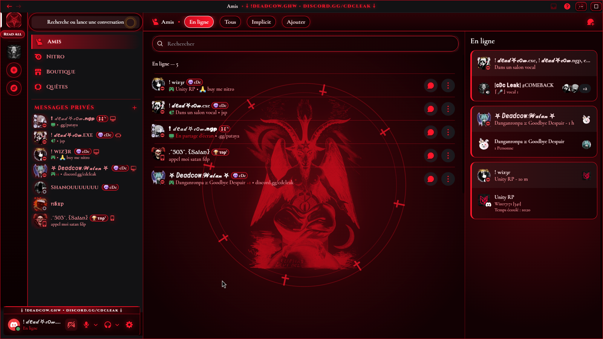

<div align="center">

# Codex Satanas
### Thème Occulte Historique & Nuances Cramoisies pour Discord

[English](README.md) • [Français](README.fr.md)

<br/>

[](https://github.com/zitk9/Codex-Satanas/releases)
[](https://discord.gg/cdcleak)
[](https://discord.gg/cdcleak)
[](#compatibilité)
[](LICENSE)

<br/>



</div>

---

## Présentation

Codex Satanas est un thème open-source pour Discord basé sur des teintes rouge sang artériel et noir d'obsidienne. Il supprime les gris ternes et beiges par défaut de l'interface Discord et intègre de vraies gravures historiques sur bois du XVIe et XIXe siècle (sans images générées par IA) :

- **Stanislas de Guaita (1897)** : *La Clef de la Magie Noire* (Sceau de Baphomet avec les inscriptions hébraïques d'origine).
- **Éliphas Lévi (1856)** : *Dogme et Rituel de la Haute Magie* (Le Bouc Sabbatique).
- **Grimorium Verum (1517)** : Le Sceau complet de Lucifer.

Tous les éléments sont gérés en CSS natif avec des filtres vectoriels et WebP intégrés pour garantir zéro ralentissement sur l'application.

---

## Modifications apportées

- **Système de couleurs unifié** : Toutes les variables de l'interface (y compris la mise à jour visuelle 2026 de Discord) sont redéfinies en rouge artériel (`#ff172b`), rouge sang (`#cc0a1d`) et sang coagulé (`#3d050b`).
- **Contrôles ergonomiques** : Boutons de fenêtre (réduire, agrandir, fermer), barre vocale (soundboard, partage d'écran, caméra, micro) repensés en touches capsules nettes sans déformation.
- **Grille vocale adaptée** : Cartes des participants avec fond verre rouge sombre, filigrane Baphomet et halo de prise de parole.
- **Polices incluses** : *Cinzel Decorative*, *UnifrakturMaguntia*, *Cormorant Garamond* et *JetBrains Mono*.
- **Compatibilité Vencord** : Support natif du lecteur Spotify, des badges de serveur et des extensions Vencord.

---

## Compatibilité

Codex Satanas utilise les variables CSS standards et les en-têtes BetterDiscord / Vencord. Il fonctionne sur n'importe quel client ou extension supportant l'injection CSS :

| Client | Statut | Méthode d'installation |
| :--- | :---: | :--- |
| **Vencord** (Desktop) | Supporté | Lien direct Online Theme ou `.theme.css` local |
| **Vesktop** (Linux / Win / macOS) | Supporté | Lien direct Online Theme ou `.theme.css` local |
| **BetterDiscord** | Supporté | Déposer le `.theme.css` dans le dossier des thèmes |
| **Equicord** | Supporté | Online Theme ou dossier local |
| **Legcord** | Supporté | Panneau Custom CSS |
| **ArmCord** | Supporté | Panneau Custom CSS |
| **Dorion** | Supporté | Panneau Custom CSS |
| **Discord Web** (Chrome / Firefox / Brave) | Supporté | Extension Stylus ou Vencord Web |

---

## Installation

### Vencord / Vesktop (Thème en ligne - Recommandé)

1. Ouvrez les Paramètres de Discord > **Vencord** (ou **Vesktop**) > **Themes**.
2. Collez ce lien dans le champ **Online Themes** :
   ```text
   https://raw.githubusercontent.com/zitk9/Codex-Satanas/main/codex-satanas.theme.css
   ```
3. Appuyez sur Entrée. Le thème s'applique directement et recevra les futures mises à jour automatiquement.

---

### BetterDiscord / Installation locale

1. Téléchargez [`codex-satanas.theme.css`](https://raw.githubusercontent.com/zitk9/Codex-Satanas/main/codex-satanas.theme.css).
2. Ouvrez les Paramètres de Discord > **Themes** (sous BetterDiscord ou Vencord).
3. Cliquez sur **Open Themes Folder** (Ouvrir le dossier des thèmes).
4. Déplacez le fichier `codex-satanas.theme.css` dans ce dossier :
   - **Linux** : `~/.config/BetterDiscord/themes/` ou `~/.config/Vencord/themes/`
   - **Windows** : `%appdata%\BetterDiscord\themes\` ou `%appdata%\Vencord\themes\`
   - **macOS** : `~/Library/Application Support/BetterDiscord/themes/`
5. Activez l'interrupteur dans votre liste de thèmes.

---

### Navigateur (Discord Web via Stylus)

1. Installez l'extension [Stylus](https://add0n.com/stylus.html) sur votre navigateur.
2. Ouvrez Stylus > Créez un nouveau style pour `discord.com`.
3. Copiez l'intégralité de [`codex-satanas.theme.css`](codex-satanas.theme.css) et collez-le.
4. Sauvegardez le style.

---

## Personnalisation

Les teintes principales peuvent être ajustées directement dans les variables `:root` :

```css
:root {
  --crimson-bright: #ff172b;  /* Rouge artériel vif */
  --crimson-wet:    #cc0a1d;  /* Rouge sang net */
  --crimson-artery: #960816;  /* Rouge profond */
  --crimson-clot:   #3d050b;  /* Sang coagulé sombre */
  --crimson-abyss:  #0d0102;  /* Noir d'obsidienne de fond */
}
```

---

## Communauté & Contact

- Auteur : `!deadcow.ghw`
- Discord : [discord.gg/cdcleak](https://discord.gg/cdcleak)
- Pour signaler un bug ou proposer une modification, ouvrez une issue sur GitHub.

---

## Licence

Licence MIT. Consultez [LICENSE](LICENSE) pour plus de détails.
Gravures historiques issues du domaine public.
