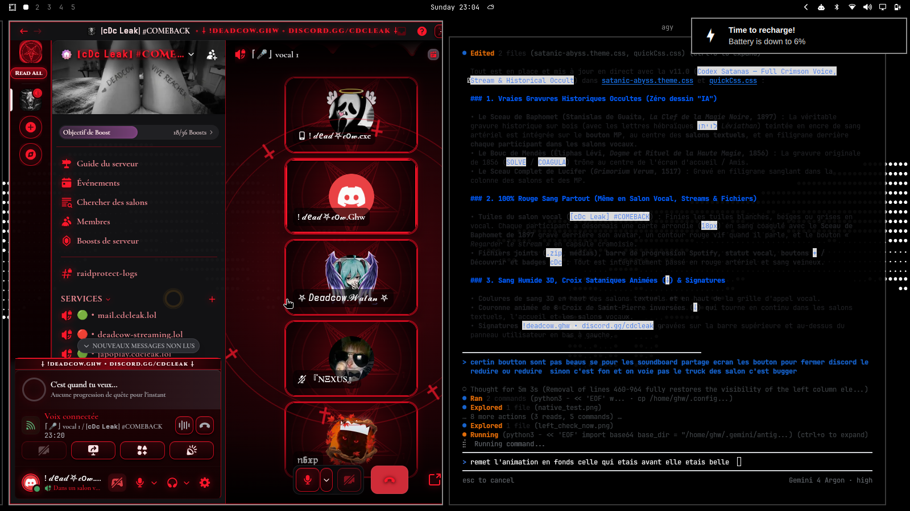

<div align="center">

# ⸸ Codex Satanas ⸸
### *Thème Occulte Historique & Sang Viscéral Intégral pour Discord*

[](README.md)
[](#)

<br/>

[](https://github.com/zitk9/Codex-Satanas/releases)
[](https://discord.gg/cdcleak)
[](https://discord.gg/cdcleak)
[](#-compatibilité-multi-clients)
[](LICENSE)

<br/>

**[ 🇬🇧 English ](README.md) • [ 🇫🇷 Français ](README.fr.md)**

<br/>



</div>

---

## 🩸 Présentation

**Codex Satanas** est un thème Discord complet, viscéral et sombre conçu sans aucun compromis. Il éradique intégralement les gris par défaut, les bronzes ternes et les beiges délavés de l'interface Discord moderne pour les remplacer par du **rouge sang artériel (`#ff172b`, `#cc0a1d`)**, du **sang coagulé sombre (`#3d050b`)** et un **noir d'obsidienne pur (`#0d0102`)**.

Contrairement aux créations artificielles ou générées par IA, **Codex Satanas** s'appuie sur de véritables **gravures sur bois occultes et satanistes des XVIᵉ et XIXᵉ siècles**, restaurées en encre de sang :
- ⛧ **Le Sceau de Baphomet** (*Stanislas de Guaita, La Clef de la Magie Noire, 1897*) avec les inscriptions hébraïques authentiques (`לויתן` - *Léviathan*) et le Bouc de Mendès.
- 🜏 **Le Bouc Sabbatique / Baphomet** (*Éliphas Lévi, Dogme et Rituel de la Haute Magie, 1856*) arborant `SOLVE` et `COAGULA`.
- ⸸ **Le Véritable Sceau de Lucifer** (*Grimorium Verum, 1517*).

---

## ⚡ Fonctionnalités Clés

* 🩸 **100% Rouge Sang & Noir Abyssal** : Remplacement exhaustif de toutes les variables et classes de Discord (y compris la refonte *visual refresh* 2026, icônes, bordures, survols et bulles d'aide).
* ⸸ **Reliques Occultes Animées** : Couronne rituelle en orbite continue composée de Croix de Saint-Pierre inversées (`⸸`) et de Croix de Léviathan (`🜏`) avec pulsations lumineuses.
* 🧪 **Coulures de Sang Réalistes en 3D** : Effets de liquide organique et de brillance spectrale via filtres SVG (`feTurbulence`, `feDisplacementMap`, `feSpecularLighting`) au sommet de l'interface.
* 🎙️ **Interface Vocale & Partage d'Écran Dédiée** : Tuiles des participants en verre d'obsidienne rouge sombre (`18px`), filigrane historique de Baphomet et halos de parole incandescents.
* 🎛️ **Contrôles Ergonomiques Pro** : Boutons de fenêtre (Réduire / Agrandir / Fermer), barre d'action vocale (*soundboard*, partage d'écran, caméra, micro) repensés en médaillons sans déformation.
* 🎵 **Lecteur Spotify & Vencord Intégrés** : Barre de progression liquide cramoisie, reflets synchronisés et badges de serveur personnalisés.
* 🖋️ **Typographies Gothiques & Antiques** : Polices *Cinzel Decorative*, *UnifrakturMaguntia*, *Cormorant Garamond* et *JetBrains Mono*.

---

## 🌐 Compatibilité Multi-Clients

Codex Satanas respecte rigoureusement les spécifications ouvertes CSS de Discord. Il est compatible avec l'ensemble des clients modifiés et injecteurs CSS :

| Client / Environnement | Niveau de Support | Méthode d'Installation |
| :--- | :---: | :--- |
| **Vencord** (Desktop) | 🟢 **100% Natif** | Thème en ligne en 1 clic ou fichier local |
| **Vesktop** (Linux / Win / Mac) | 🟢 **100% Natif** | Thème en ligne en 1 clic ou fichier local |
| **BetterDiscord** | 🟢 **100% Natif** | Déposer `.theme.css` dans le dossier des thèmes |
| **Equicord** | 🟢 **100% Natif** | Thème en ligne ou fichier local |
| **Legcord** | 🟢 **Compatible** | Menu Custom CSS / Vencord |
| **ArmCord** | 🟢 **Compatible** | Injection CSS personnalisée |
| **Dorion** | 🟢 **Compatible** | Paramètres > Custom CSS |
| **OpenAsar** | 🟢 **Compatible** | Injecteur QuickCSS |
| **Discord Web** (Chrome / Firefox / Brave) | 🟢 **Compatible** | Extension **Stylus** ou Vencord Web |

> [!NOTE]
> **Comment savoir si un autre client est compatible ?**
> Si votre client alternatif Discord permet d'activer un fichier `.theme.css`, d'injecter du code CSS personnalisé ou d'ajouter une URL distante, **Codex Satanas fonctionnera sans modification**.

---

## 📥 Guide d'Installation

### Méthode 1 : Vencord & Vesktop (Installation rapide en 1 clic — Recommandée)

1. Ouvrez Discord.
2. Allez dans les **Paramètres utilisateur** (⚙️) > **Vencord** (ou **Vesktop**) > **Thèmes** (*Themes*).
3. Dans la zone **Thèmes en ligne** (*Online Themes*), collez le lien direct suivant :
   ```text
   https://raw.githubusercontent.com/zitk9/Codex-Satanas/master/codex-satanas.theme.css
   ```
4. Appuyez sur **Entrée** ou activez le bouton. Le thème s'applique instantanément et se mettra à jour automatiquement !

---

### Méthode 2 : BetterDiscord / Fichier local

1. Téléchargez le fichier [`codex-satanas.theme.css`](https://raw.githubusercontent.com/zitk9/Codex-Satanas/master/codex-satanas.theme.css).
2. Ouvrez Discord > **Paramètres utilisateur** (⚙️) > **Thèmes** (sous *BetterDiscord* ou *Vencord*).
3. Cliquez sur **Ouvrir le dossier des thèmes** (*Open Themes Folder*).
4. Placez-y le fichier `codex-satanas.theme.css` :
   * **Linux** : `~/.config/BetterDiscord/themes/` ou `~/.config/Vencord/themes/`
   * **Windows** : `%appdata%\BetterDiscord\themes\` ou `%appdata%\Vencord\themes\`
   * **macOS** : `~/Library/Application Support/BetterDiscord/themes/`
5. Activez l'interrupteur **Codex Satanas** dans Discord.

---

### Méthode 3 : Discord Web (Navigateur via Stylus)

1. Installez l'extension [Stylus](https://add0n.com/stylus.html) sur Chrome, Brave, Firefox ou Edge.
2. Cliquez sur l'icône de Stylus > **Écrire un style pour: `discord.com`**.
3. Copiez tout le contenu de [`codex-satanas.theme.css`](codex-satanas.theme.css) et collez-le dans l'éditeur.
4. Enregistrez et rechargez Discord Web.

---

## 🛠️ Nuances & Personnalisation CSS

Toutes les nuances peuvent être éditées à la racine `:root` du thème :

```css
:root {
  --crimson-bright: #ff172b;  /* Rouge sang artériel éclatant */
  --crimson-wet:    #cc0a1d;  /* Sang frais liquide */
  --crimson-artery: #960816;  /* Sang artériel profond */
  --crimson-clot:   #3d050b;  /* Sang coagulé noirci */
  --crimson-abyss:  #0d0102;  /* Noir d'obsidienne fondamental */
}
```

---

## 🤝 Communauté & Support

* **Créateur** : `!deadcow.ghw`
* **Discord Officiel** : [discord.gg/cdcleak](https://discord.gg/cdcleak)
* **Signalement de bugs & demandes** : Ouvrez une issue sur ce dépôt GitHub.

---

## ⚖️ Licence

Sous licence **MIT**. Consultez [LICENSE](LICENSE) pour plus d'informations.
Gravures historiques issues du domaine public (Stanislas de Guaita 1897, Éliphas Lévi 1856, Grimorium Verum 1517).
